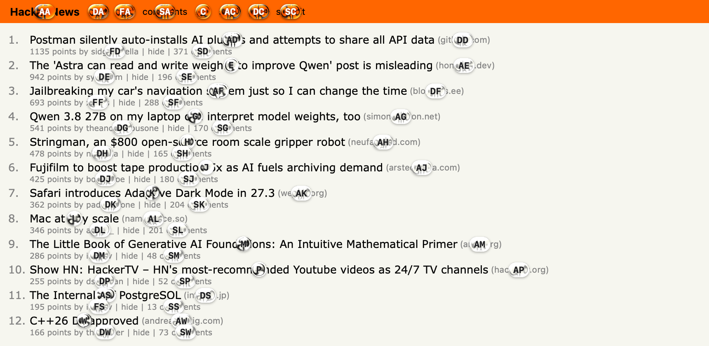
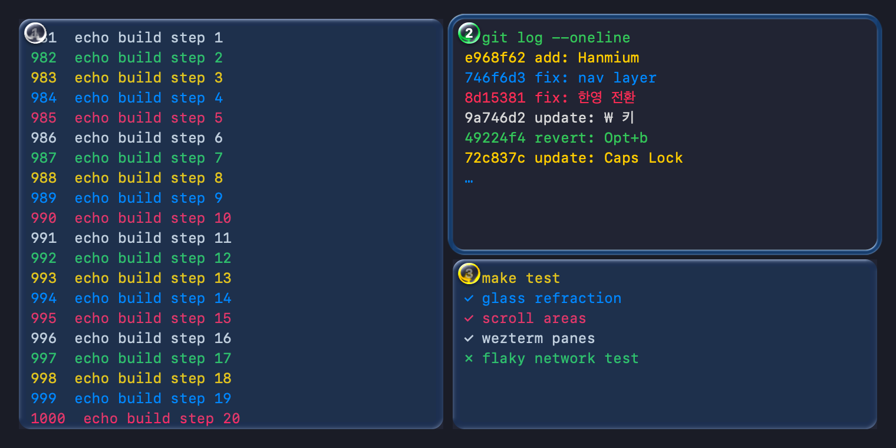
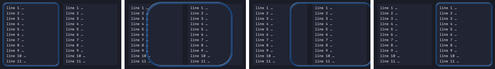
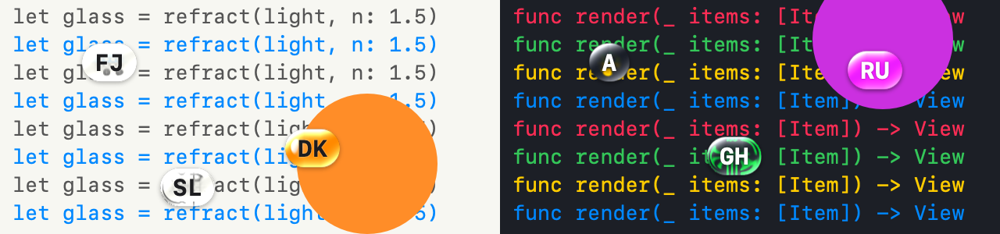
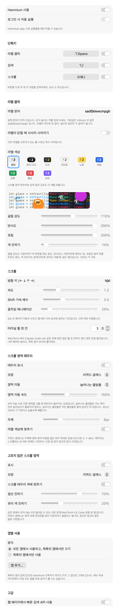

# Hanmium





키보드만으로 화면의 버튼·링크를 누르고, 글자로 찾고, 스크롤하는 macOS 메뉴 막대 앱(Swift).
라벨과 스크롤 테두리를 Apple Liquid Glass 처럼 **실제로 뒤 화면을 굴절시켜** 그린다.

| 단축키 | 모드 | 하는 일 |
|---|---|---|
| `⌥Space` | 라벨 클릭 | 누를 수 있는 요소마다 라벨을 붙이고, 라벨 글자를 치면 그 요소를 누른다 |
| `⌥/` | 검색 | 버튼·링크의 글자로 찾아 누른다 |
| `⇧⌘J` | 스크롤 | 스크롤할 영역(분할 창 포함)을 골라 키보드로 부드럽게 스크롤한다 |

단축키는 설정에서 바꿀 수 있다.

## 목차

- [기능](#기능)
- [설치](#설치)
- [사용법](#사용법) — [라벨 클릭](#라벨-클릭--space) · [검색](#검색--) · [스크롤](#스크롤--j)
- [리퀴드 글래스](#리퀴드-글래스)
- [설정](#설정)
- [문제가 생기면](#문제가-생기면)
- [구조](#구조)

## 기능

- **라벨 클릭**: 앞에 있는 앱의 창, 메뉴 막대(앱 메뉴와 상태 아이콘), Dock 의 누를 수 있는 요소에 라벨을 붙인다.
  - 라벨은 모두 같은 길이(1~2글자)다.
  - 한글 입력기가 켜져 있어도 라벨 글자를 자판 위치 그대로 받는다.
- **어느 앱에서나**: 손쉬운 사용(AX) 정보로 요소를 찾는다.
  - Chrome·Slack·VS Code 같은 웹 화면(Electron·Chromium)은 앱마다 규칙을 두지 않고 공통 규칙으로 안쪽 스크롤 영역까지 찾는다.
  - WezTerm 분할 창은 `wezterm cli` 로 위치를 알아낸다.
- **스크롤**: 커서를 옮기지 않고 그 창에 직접 휠 이벤트를 보낸다.
  - 링크 위에 커서가 올라가 미리보기가 뜨는 일이 없다.
  - `d`/`u` 는 반 페이지씩 부드럽게 움직이고, 누르고 있으면 계속 간다.
- **분할 창 고르기**: WezTerm·VS Code·Slack 의 분할 창이나 여러 창 중 스크롤할 곳을 숫자·Tab 으로 고르고, Enter 로 그 창에 포커스를 옮긴다.
- **리퀴드 글래스**: 단축키를 누를 때 화면을 찍어(Hanmium 자신은 빼고) 라벨·스크롤 테두리 가장자리에서 실제로 굴절시킨다.
  - 계산은 GPU(Metal)로 한다.
  - 라벨이 다 그려지기까지 단축키를 누르고 80ms 안팎.
- **앱별 사용**: 특정 앱에서만 끄거나, 특정 앱에서만 켠다. 꺼진 앱이 앞에 있으면 단축키를 놓아서 그 앱이 키를 그대로 받는다.
- **설정 내보내기·가져오기**: JSON 파일로 옮기거나 되돌린다.
- **진단**: 앱 호환성 점검, 동작 로그, 단계별 시간 측정.

## 설치

**요구 사항**

- macOS 13 이상. 리퀴드 글래스의 화면 캡처는 macOS 14 이상에서 되고(그 아래는 흐림으로 그림), 15.2 이상이면 더 빠르다.
- Xcode 또는 Command Line Tools (Swift 5.9 이상). Metal 셰이더는 실행 중에 컴파일하므로 Xcode 의 Metal 컴파일러가 없어도 된다.

```sh
./build.sh                  # build/Hanmium.app 을 만든다
open build/Hanmium.app
```

**권한**

처음 실행하면 시스템 설정 › 개인정보 보호 및 보안에서 허용한다.

| 권한 | 필요한 까닭 |
|---|---|
| 손쉬운 사용 (필수) | 화면 요소 찾기, 클릭·휠 이벤트 보내기 |
| 화면 기록 (선택) | 리퀴드 글래스의 굴절. 없으면 흐림으로만 그린다. 캡처하는 동안 메뉴 막대 오른쪽에 macOS 의 보라색 점이 잠깐 보인다 |

메뉴 막대 아이콘에 마우스를 올리면 툴팁으로 권한 상태가 보인다.

**서명**

`build.sh` 는 키체인에 **"Hanmium Local Code Signing"** 코드 서명 인증서가 있으면 그걸로 서명한다. 서명 주체가 같아서 다시 빌드해도 손쉬운 사용 권한이 유지된다. 없으면 임시(ad-hoc) 서명이라 빌드할 때마다 권한을 다시 허용해야 한다.

인증서 만드는 법: 키체인 접근 › 인증서 지원 › 인증서 생성… 에서 다음처럼 만든다.

- 이름: `Hanmium Local Code Signing`
- 신원 유형: 자체 서명 루트
- 인증서 유형: 코드 서명

**그 밖**

- 로그인 시 자동 실행은 설정에서 켠다.
- Hanmium 을 새로 실행하면 먼저 떠 있던 Hanmium 은 끝난다. 메뉴 막대 아이콘과 단축키가 둘이 되지 않는다.

## 사용법

### 라벨 클릭 — `⌥Space`

| 키 | 동작 |
|---|---|
| 라벨 글자 | 그 요소를 누른다 |
| 마지막 글자를 `Shift` 와 함께 | 오른쪽 클릭 |
| 마지막 글자를 `⌘` 와 함께 | ⌘-클릭 (새 탭 등) |
| 마지막 글자를 `⌥` 와 함께 | 더블클릭 |
| `⌫` | 한 글자 지우기 |
| `/` | 검색 모드로 바꾸기 |
| `Esc` 또는 `⌥Space` | 닫기 |

- **WezTerm 분할 창**: 분할 창 라벨을 고르면 마우스를 누르지 않고 `wezterm cli activate-pane` 으로 그 창으로 옮긴다. Claude Code·vim 처럼 마우스를 받는 프로그램에 클릭이 들어가지 않게 하려는 것이다.
- **라벨 문자**: 설정에서 바꾼다. 앞쪽 문자가 먼저 쓰이니 손이 놓이는 키를 앞에 둔다. 기본값은 `fjdkslaghrueiwoqptyvncmxbz` 이다.

### 검색 — `⌥/`

| 키 | 동작 |
|---|---|
| 글자 입력 | 버튼·링크의 제목·설명·값으로 찾는다 |
| `Tab` / `↓` | 다음 결과 |
| `Shift-Tab` / `↑` | 이전 결과 |
| `Return` | 누르기 (`Shift` 오른쪽 클릭, `⌘` ⌘-클릭, `⌥` 더블클릭) |
| `Esc` | 닫기 |

### 스크롤 — `⇧⌘J`

맨 위 두 번째 그림처럼 여러 분할 창 중 하나를 골라 스크롤한다.

| 키 | 동작 |
|---|---|
| `h` `j` `k` `l` · 화살표 | 누르는 동안 부드럽게 스크롤 (방향 키는 설정에서 바꾼다) |
| 위 키 + `Shift` | 빠르게 |
| `d` / `u` | 반 페이지 아래 / 위 (누르고 있으면 빠르게 계속) |
| `gg` / `G` | 맨 위 / 맨 아래 |
| `1`–`9` | 창이 여러 개면 그 번호의 창 (같은 번호를 다시 누르면 그 창의 다음 영역), 창이 하나면 그 번호의 영역 |
| `Tab` / `Shift-Tab`, `⌃N` / `⌃P` | 다음 / 이전 영역 |
| `Enter` | 그 영역을 눌러 포커스를 옮기고 닫기 (WezTerm 은 그 분할 창으로 전환) |
| `Esc` 또는 `⇧⌘J` | 닫기 |

**시작 영역**은 이 순서로 정한다.

1. 키보드 포커스가 그대로면 마지막으로 쓰던 영역(이어서 보기)
2. 포커스가 바뀌었으면 포커스가 있는 영역 (WezTerm 은 활성 분할 창)
3. 둘 다 없으면 가장 큰 영역

**그 밖에 알아 둘 것**

- **모드 닫힘**: 마우스를 누르거나 다른 앱으로 넘어가면 닫힌다.
- **테두리**: 고른 영역은 유리 막대로 감싸고, 같은 창의 다른 영역은 옅은 색 유리판으로 표시한다. 설정에서 실선·점선으로 바꾸고, 두께와 색을 고른다.
- **WezTerm**
  - 분할 창 위치를 `wezterm cli` 와 `~/.wezterm.lua` 의 `window_padding` 으로 계산한다.
  - Claude Code·vim 같은 전체 화면 프로그램은 휠 한 칸마다 정해진 만큼 움직여서, 설정의 '터미널 휠 한 칸'(줄 수)으로 속도를 맞춘다.
- **영역 이동 효과(선택, 기본 꺼짐)**: 다른 영역을 고를 때 테두리가 물방울처럼 늘어나며 옮겨가게 할 수 있다. 설정 › 스크롤 영역 테두리 › 영역 이동에서 '늘어나는 물방울'이나 '날아가는 물방울'을 고른다.



## 리퀴드 글래스



[kube.io 의 "Liquid Glass in the Browser"](https://kube.io/blog/liquid-glass-css-svg/) 모델을 따른다.

- **표면**: 볼록 스퀘어클 단면 `y = (1 - (1 - x)^4)^(1/4)`. 가장자리 띠(베젤)만 휘고 안쪽은 평평하다.
- **굴절**: 빛이 위에서 수직으로 들어온다고 보고 스넬 법칙(공기 1 → 유리 1.5)으로 꺾인 각을 구한다. 뒤 화면 자리는 `높이 × tan(입사각 - 굴절각)` 만큼 안쪽으로 밀린다.
- **가장자리 빛**: 표면이 빛 쪽(왼쪽 위 -60°)을 향할수록 밝고, 맞은편은 되비친 빛으로 약하다.
- **글자색**: 뒤 밝기를 보고 어두운 글자/밝은 글자를 고른다.

**그리는 방법**

- 단축키를 누르는 순간 화면을 찍는다(ScreenCaptureKit). Hanmium 자신의 창은 빼고 찍는다. 빼지 않으면 유리가 자기 자신을 다시 굴절시켜 색이 쌓인다.
- 굴절은 Metal 셰이더로 계산한다. 라벨은 한 장에 모아 한 번에 그린다. CPU 로 라벨 250개에 약 125ms 걸리던 것이 GPU 로 약 5ms 다.
- 스크롤 모드 동안에는 화면을 계속 받아 스크롤한 뒤에도 굴절이 바로 바뀐다.

**라벨 색상**은 유리 · 유리 다크 · 다크 · 라이트 · 노랑 · 파랑 · 초록 · 빨강 · 보라 중에서 고른다. 유리를 고르면 굴절 강도 · 반사도 · 흐림 · 색 진하기를 미리보기를 보며 조절한다.

## 설정

메뉴 막대 아이콘 › **설정…**



| 구역 | 항목 |
|---|---|
| 일반 | Hanmium 사용, 로그인 시 자동 실행, 화면 기록 권한 안내 |
| 단축키 | 세 모드의 단축키(버튼을 누르고 새 조합 입력)와 모드별 켜기·끄기 |
| 라벨 클릭 | 라벨 문자, 라벨 색상, 유리 조절(굴절 강도·반사도·흐림·색 진하기)과 미리보기 |
| 스크롤 | 방향 키, 속도, Shift 가속 배수, 움직임 애니메이션, 터미널 휠 한 칸(줄 수) |
| 스크롤 영역 테두리 | 표시, 모양(리퀴드 글래스/실선), 영역 이동 효과와 속도, 두께, 색 |
| 고르지 않은 스크롤 영역 | 표시, 모양(리퀴드 글래스/점선), 색, 진하기 |
| 앱별 사용 | 목록의 앱에서만 끄기 / 목록의 앱에서만 쓰기, 앱 추가 |
| 고급 | 웹 페이지 빠른 검색 API, **설정 내보내기·가져오기** |

- **메뉴 막대 메뉴**: 단축키 상태, 사용 켜기·끄기, 지금 앱에서 끄기/켜기, 지금 앱 점검을 바로 할 수 있다.
- **명령으로 바꾸기**: `defaults write com.local.Hanmium <키> <값>` 으로도 바꿀 수 있다. 단축키 외에는 바로 적용된다.

## 문제가 생기면

| 방법 | 보는 것 |
|---|---|
| 메뉴 막대 › **‹앱› 점검…** | 그 앱에서 클릭 대상·스크롤 영역·분할 창·포커스를 제대로 찾는지, 느린지 |
| `~/Library/Logs/Hanmium.log` | 스크롤 모드가 찾은 영역·포커스·시작 영역, Enter, 라벨이 뜨기까지 단계별 시간 |
| `.build/release/Hanmium --dump [번들ID]` | 그 앱의 클릭 대상과 스크롤 영역 목록 (화면에 아무것도 띄우지 않음) |
| `.build/release/Hanmium --check [번들ID]` | 호환성 점검. 번들 ID 를 빼면 실행 중인 앱 전부, 경고가 있으면 종료 코드 1 |
| `Tools/check-apps.sh` | 위 점검을 빌드와 함께 (코드를 고친 뒤 회귀 확인) |
| `Tools/e2e-wezterm.sh` | 시험용 WezTerm 창을 띄워 스크롤 모드를 실제 키로 돌려 보는 회귀 테스트 |
| `defaults write com.local.Hanmium profile -bool true` | 라벨 찾기 단계별 시간을 로그에 남긴다 (끄기: `defaults delete com.local.Hanmium profile`) |

명령줄 옵션은 `--dump`, `--check`, `--settings`(설정 창과 함께 실행), `--click`·`--search`·`--scroll`(실행 1초 뒤 그 모드) 이다. 모르는 옵션이면 앱으로 뜨지 않고 사용법만 출력한다. 뜨면 실행 중인 Hanmium 을 대신해 버리기 때문이다.

테스트·측정 기록은 [TESTING.md](TESTING.md) 에 있다.

## 구조

| 파일 | 하는 일 |
|---|---|
| `Sources/Hanmium/main.swift` | 시작점, 명령줄 옵션 |
| `AppDelegate.swift` | 단축키, 모드 띄우기·닫기, 단일 실행, 단계별 시간 기록 |
| `TreeBuilder.swift` | AX 트리 훑기: 클릭 대상, 스크롤 영역(웹 공통 규칙), 포커스 영역, 상태 아이콘 캐시 |
| `ClickMode.swift` | 라벨 클릭·검색 모드, 라벨 만들기 |
| `ScrollMode.swift` | 스크롤 모드: 영역 고르기, 부드러운 스크롤, Enter 클릭, 시작 영역 기억 |
| `Input.swift` | 단축키(Carbon), 키 코드 → 글자(한글 입력기에서도), 클릭·휠 이벤트 |
| `AX.swift` | AX 호출 도우미, 화면 요소 |
| `WezTerm.swift` | `wezterm cli` 로 분할 창 위치·활성 창, `~/.wezterm.lua` 읽기 |
| `Overlay.swift` | 투명 오버레이 창, 라벨·테두리·유리 그리기, 라벨 색상 |
| `LiquidGlass.swift` | 굴절 모델(CPU), 화면 캡처·연속 캡처 |
| `GlassGPU.swift` | 굴절 Metal 셰이더 (실행 중 컴파일) |
| `Droplet.swift` | 영역 이동 물방울 움직임(스프링) |
| `Diagnostics.swift` | 앱 호환성 점검 |
| `Settings.swift` | 설정 창(SwiftUI) |
| `StatusItem.swift` | 메뉴 막대 아이콘과 메뉴 |
| `Config.swift` | 설정 값, 설정 내보내기·가져오기 |
| `Demos/` | 기능을 넣기 전에 비교해 본 예시 앱 (`Demos/build.sh DropletDemo`, `LinkLabelsDemo`) |
| `Tools/` | 회귀 테스트, README 이미지 만들기(`make-doc-images.sh`) |

README 의 이미지는 `Tools/make-doc-images.sh` 로 다시 만든다. 실제 화면을 찍지 않는다. Hanmium 의 그리기 코드로 가짜 화면과 설정 창을 화면 밖에서 그린다.
